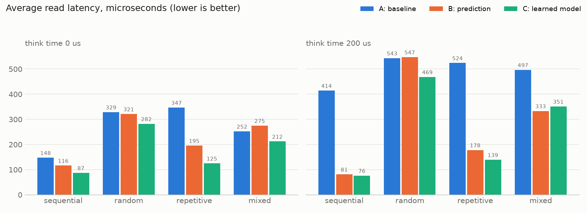
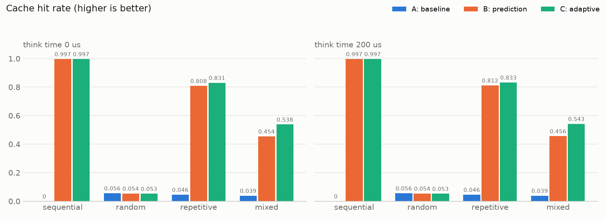
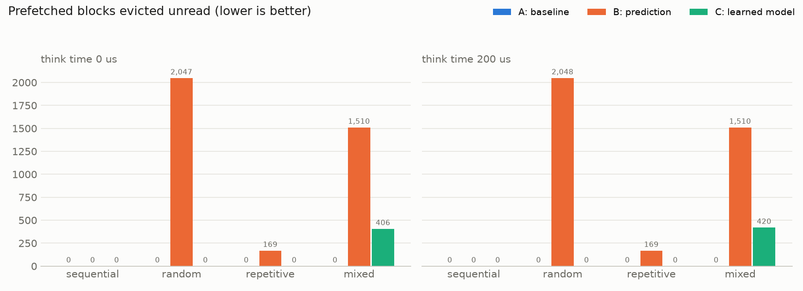
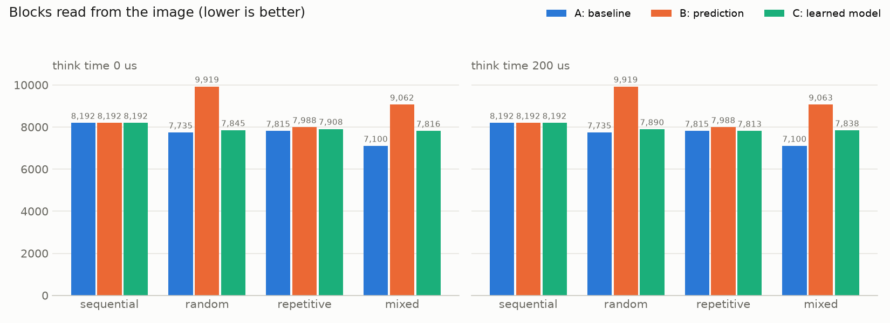
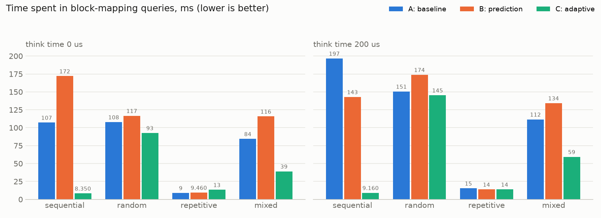

# Evaluation

All numbers here were measured on one machine by `python/evaluate.py`. The raw
rows are in [experiments/results.csv](../experiments/results.csv) and every
metric is tabulated in [experiments/summary.md](../experiments/summary.md).

Version C is the project: a scikit-learn decision tree, trained in Python on
the reads while the filesystem runs and followed by the filesystem to predict
which blocks to prefetch. A (no prediction) and B (hand-written prediction)
are the comparisons.

## Summary

- **The model learns the patterns by itself.** It predicts sequential and repeating reads and predicts nothing on random ones.
- **No think time:** C has the lowest read latency on every workload: 81 us against B's 121 on sequential, 121 against 193 on repetitive, 212 against 265 on mixed.
- **With 200 us of think time:** C and B are level on sequential (77 and 80 us). C is behind B on repetitive (175 against 158 us) and mixed (364 against 331 us), though the repetitive runs varied too much to call (146 to 222 us).
- **Waste:** C wastes no prefetches on the sequential, random and repetitive workloads, where B wastes about 2,050 on random and 169 on repetitive. On mixed C wastes about 410, against B's 1,510.
- **Where C is behind:** on the mixed workload it serves 24% of reads from prefetch against B's 42%.
- **Against the earlier rule-based version C:** the model is now faster on repetitive reads and slower on sequential and mixed (see the last section).

## Setup

| | |
|---|---|
| Data | 8 files of 512 blocks (16 MiB) |
| Cache budget | 1024 KiB, about 6% of the data, shared by both caches |
| Run length | 8192 block-sized operations |
| Repetitions | 3 seeds per configuration; tables show the median |
| I/O | image opened with `O_DIRECT` on ext4, so each cache miss is a real device read |
| Think time | 0 us (requests back to back) and 200 us (an application that works on each block) |
| Machine | WSL2 Linux 6.6, 20 logical CPUs, virtual disk |
| Model | started fresh for every run, so it has seen nothing before the first read |
| Model settings | 4 reads ahead, trained on the last 2,048 reads, retrained every 256 reads |

Workloads:

- **sequential**: every file read front to back.
- **random**: uniformly random blocks.
- **repetitive**: one fixed random order of 600 blocks, repeated. It is longer than the cache holds, so LRU alone cannot keep it.
- **mixed**: sequential, repetitive and random phases of 512 operations each, with one operation in ten a write.

The benchmark calls the filesystem library directly rather than through a
mount. FUSE adds the same per-request overhead to every version, so leaving it
out makes the differences easier to see; absolute latencies through a mount
will be higher.

## Read latency

Average read latency in microseconds (lower is better):

| Workload | Think 0: A | B | C | Think 200: A | B | C |
|---|---:|---:|---:|---:|---:|---:|
| sequential | 158 | 121 | 81 | 435 | 80 | 77 |
| random | 315 | 300 | 254 | 509 | 487 | 460 |
| repetitive | 303 | 193 | 121 | 506 | 158 | 175 |
| mixed | 242 | 265 | 212 | 483 | 331 | 364 |

- **No think time:** C is fastest everywhere. It predicts 4 blocks ahead where B predicts 2, so more prefetches finish before the block is asked for, and it loads block mappings 32 at a time.
- **With think time:** even B's 2 blocks ahead have time to arrive, so that advantage disappears. C is level with B on sequential and behind on mixed, where it predicts fewer reads. On repetitive the three C runs ranged from 146 to 222 us, so the 175 against 158 is not a reliable difference.
- **Random:** C measures faster than A and B, but nothing was prefetched, so the model's predictions cannot be the cause. Timings on this machine shift with what else is running (version A alone got about 25% faster while an unrelated program kept one processor busy). Read the random row as "no difference".
- Every version is slower with think time, A included. The reader thread sleeps between requests and pays a wake-up cost on each one; compare versions within a column, not across columns.

## What the model learned

Share of reads served from a prefetched block (the two think-time columns agree to within a point):

| Workload | B | C |
|---|---:|---:|
| sequential | 0.997 | 0.997 |
| random | 0.011 | 0.000 |
| repetitive | 0.766 | 0.814 |
| mixed | 0.422 | 0.236 |

- **Sequential:** the same as B.
- **Repetitive:** better than B. The order contains repeated blocks, so some blocks have two possible followers. The tree is told the two jumps before each read and can tell them apart; B's table cannot.
- **Mixed:** this is the model's weak case. The pattern changes every 512 operations, and the model only learns a new pattern at its next training (up to 256 reads later) and only after seeing it twice. Its window also holds the random phases, which the tree has to work around.
- **Random:** it predicts nothing, because no leaf of the tree is pure.

The model's accuracy figure (running share of reads that were the tree's first
guess) ends at 1.00 on sequential and repetitive reads, 0.35 on mixed and 0 on
random.

## Cache hit rate and prefetching

With no think time:

| Workload | Hit rate A | B | C | Prefetch precision B | C | Wasted B | C |
|---|---:|---:|---:|---:|---:|---:|---:|
| sequential | 0.000 | 0.997 | 0.997 | 1.000 | 1.000 | 0 | 0 |
| random | 0.056 | 0.054 | 0.056 | 0.043 | none issued | 2,047 | 0 |
| repetitive | 0.046 | 0.807 | 0.860 | 0.974 | 1.000 | 169 | 0 |
| mixed | 0.039 | 0.454 | 0.269 | 0.674 | 0.810 | 1,510 | 406 |

Precision is the share of prefetched blocks that were read before being
evicted. A's hit rate is near zero on purpose: the cache is far smaller than
the data and none of these workloads revisits a block soon enough for LRU.

B prefetches on any block it has seen once before. The model only predicts
from a pure leaf, so on a steady pattern it is always right. On the mixed
workload it is wrong about a fifth of the time: a tree trained on one phase
keeps predicting into the next.

## Disk I/O

| Workload | A | B | C |
|---|---:|---:|---:|
| sequential | 8,192 | 8,192 | 8,192 |
| random | 7,735 | 9,919 | 7,735 |
| repetitive | 7,815 | 7,988 | 7,817 |
| mixed | 7,100 | 9,059 | 7,714 |

Prefetching does not reduce the number of blocks read; it moves reads off the
request path, and wrong guesses add reads. B adds 28% on random and mixed. C
adds none on random and 9% on mixed.

## Metadata indexing overhead

Total time in block-mapping queries, milliseconds, no think time:

| Workload | A | B | C |
|---|---:|---:|---:|
| sequential | 106 | 172 | 9 |
| random | 116 | 134 | 80 |
| repetitive | 12 | 13 | 10 |
| mixed | 83 | 121 | 60 |

- B is worse than A on sequential and mixed: looking up the mapping of each predicted block one at a time adds queries.
- When C looks up a predicted block it loads the next 32 mappings in the same query. That cuts sequential mapping queries from 8,192 to about 290. This is not machine learning; it is a fixed part of how C looks up what the model predicts, and it is part of why C's sequential latency is low.
- C's lower time on random is the same machine effect as in the latency table: it ran the same 5,313 queries as A.

## Memory and writes

- The caches stay inside the 1024 KiB budget in every version (954 to 1,022 KiB in use at the end of each run).
- The model is outside that budget: the 2,048 reads it remembers and the Python process, plus the copy of the tree the filesystem holds.
- Write latency (mixed workload only) is 260 / 253 / 203 us for A / B / C with no think time. Writes are full-block overwrites and go straight to the image in every version.

## Model against the earlier rule-based version C

Version C used to be version B plus hand-written feedback rules. Those rules
were removed and replaced by the model. Their last measured results (commit
`63f1603`, same machine and settings, no think time):

| Workload | Read latency: rules | model | Reads served by prefetch: rules | model | Wasted prefetches: rules | model |
|---|---:|---:|---:|---:|---:|---:|
| sequential | 64 | 81 | 0.997 | 0.997 | 0 | 0 |
| random | 293 | 254 | 0 | 0 | 0 | 0 |
| repetitive | 139 | 121 | 0.792 | 0.814 | 1,067 | 0 |
| mixed | 197 | 212 | 0.508 | 0.236 | 188 | 406 |

- **Repetitive:** the model is faster, predicts more and wastes nothing.
- **Sequential:** the rules were faster. They prefetched up to 8 blocks ahead; the model looks 4 ahead.
- **Mixed:** the rules were faster and predicted about twice as many reads. They reacted to a new pattern within a few reads; the model waits for its next training.
- The two sets of numbers come from runs on different days, and timings on this machine drift by tens of microseconds between runs. The size of the gaps is approximate.

## Earlier designs of the model

Three designs were measured before this one. Each kept all prediction in
Python, with the filesystem sending a read and using the answer when it
arrived. Average read latency, no think time:

| Workload | Neural network in Python | Decision tree in Python | Decision tree, followed in C++ (now) |
|---|---:|---:|---:|
| sequential | 141 | 163 | 81 |
| repetitive | 192 | 202 | 121 |
| mixed | 240 | 247 | 212 |

A Python program takes about 100 us to answer one read, longer than a cached
read takes, so its answers always arrived late. Having Python train the tree
and the filesystem follow it removed that delay. (Waiting for Python's answer
on every read was tried first and was slower than no prediction at all.)

## Limits of this evaluation

- Three runs per configuration, medians only; no confidence intervals. Differences of 10% or less should be read as no difference.
- One machine, one cache size, one file layout, synthetic workloads. No traces from real applications.
- Timings depend on what else the machine is doing, including the model's own process (see the random workload above).
- The model starts untrained in every run. A mounted filesystem that has been used before starts from its recorded reads, which was not measured.
- The model's settings were chosen by trying a few values on these same four workloads. They were not tuned on separate data.
- Only one kind of model was tried in the final system. Other scikit-learn models were not compared.
- Throughput is operations per second of time spent inside the filesystem, excluding think time.
